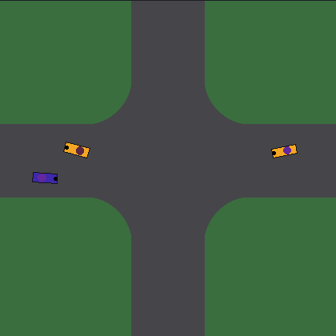

# Smart Crossing

<p align="center"><a href="https://smartcrossing.pages.dev"></a></p>
<p align="center"><em>One network steers all the cars, with no traffic light and no lanes (colour = turning direction, double speed) – <a href="https://smartcrossing.pages.dev">try it live in your browser</a>.</em></p>

**Live demo: https://smartcrossing.pages.dev** (German and English, toggle top right)

A crossing with no traffic lights, no lanes and no right-of-way rules, used only by self-driving
cars. Each car has a small neural network, senses its surroundings (road edge, the nearest cars
and their roof lamps) and learns by itself to steer, accelerate, brake and "talk" with its lamp.
What the lamp means is not predefined.

Questions the project looks at:

- How many cars per minute can learning cars get through a rule-free crossing – and how often
  do they crash while doing so?
- How do they drive when they start in the right half of the road (driving on the right is given)?
- Does a kind of language emerge through the lamps? *(So far no: the lamps send something, but
  nobody listens.)*
- What happens when differently trained cars drive together?

The website explains step by step what a car sees, what it can do, what its "brain" looks like and
how it learns. Everything runs directly in the browser.

## Try it yourself

Requirements: Python 3.13 and [Poetry](https://python-poetry.org/).

```bash
poetry install
poetry run pytest -q                                                      # tests
poetry run python -m smartcrossing.cli bench --driver reservation --demand 0.15   # key figures
poetry run python -m smartcrossing.cli render --driver light --out runs/light     # images + GIF
poetry run python -m smartcrossing.cli evalset --driver policy:results/round4_best.npz --out runs/eval.jsonl   # standard evaluation
poetry run python site/build.py                                          # build the website
cd site/public && python3 -m http.server 8000                            # view the website locally
```

## Structure

| Path | Contents |
|---|---|
| `smartcrossing/sim.py` | Simulation of the crossing (numpy, many crossings in parallel) |
| `smartcrossing/ppo.py` | Training with PPO (optionally on the GPU: `poetry install --with gpu`, then `--rollout-device cuda`; see `ppo_torch.py`, `sim_torch.py`) |
| `smartcrossing/baselines.py` | Reference drivers with lanes: traffic light and central traffic controller |
| `smartcrossing/policy.py`, `policy_set.py` | the brain: plain network (MLP) or a network with a mini-network per neighbour + attention; `policy_compat.py` loads old brains |
| `smartcrossing/bc.py` | Imitation: a new brain first learns from the old one (`ppo --init-bc`) |
| `smartcrossing/gates.py` | Stopping test: does a car stop in front of an obstacle? |
| `smartcrossing/evalset.py` | Standard evaluation (`cli evalset`): several traffic densities and random seeds + the stopping test |
| `smartcrossing/select.py` | Picking the best checkpoint of a training run (`cli select`): stopping test as a filter, then throughput |
| `smartcrossing/deadlock.py` | Jam / gridlock study and the throughput-vs-density data of the website (`cli deadlock`, `deadlock-summarize`, `cloud`) |
| `smartcrossing/protocol.py` | The fixed measurement settings: random seeds (selection vs. reporting), run length, traffic densities |
| `smartcrossing/cli.py` | All commands (`python -m smartcrossing.cli --help`) |
| `site/` | the website (German + English, `site/src/js/i18n*.js`); `site/src/js/sim.js` is the browser version of the simulation; `site/build.py` builds it (code in `site/sitebuild/`) |
| `results/` | Small final results: best brains, evaluations, the website's snapshot `results/site/` |
| `docs/PLAN.md` | Goals, decisions, architecture |
| `docs/experiments.md` | Log of all training runs |

A hobby project, developed mostly with [Claude Code](https://claude.com/claude-code).
